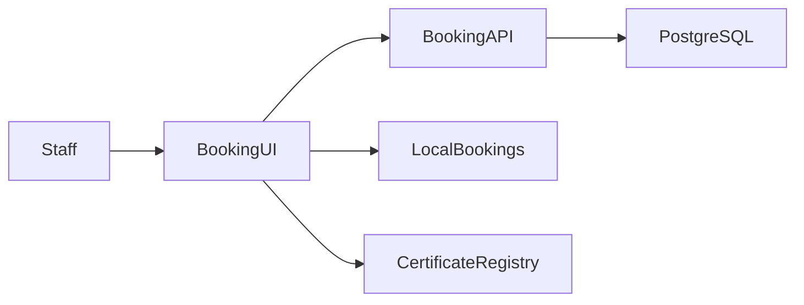

# Requirements

### Overview
Add an internal staff scheduling view for photo sessions, with an optional gift-certificate link. Booking does not redeem credit or change certificate balances.

### Behavior
- Staff can create, view, reschedule and cancel bookings, including client name, contact details, photographer, session type, location, notes, start and end times.
- Block overlapping active bookings for the same photographer; cancelled bookings do not occupy time.
- Support browser-local bookings when the API is unavailable. Clearly label them as local-only, keep them separate from server bookings, and never imply automatic synchronization or cross-device conflict protection.
- Exclude customer-facing booking, payments, notifications, external calendars and automatic certificate redemption.

# Technical Design

### Current implementation
`frontend/src/App.jsx` owns navigation, certificate state and local cache; `backend/server.js` exposes Express endpoints backed by PostgreSQL; `backend/db/schema.sql` defines the existing tables. Certificate writes use transactions, while local changes are not synchronized.

### Design
Add a bookings tab following the existing navigation and form patterns. Store scheduled instants in UTC and display/edit them in the browser's local time zone, with clear time-zone labeling. Normalize photographer names for conflict checks. PostgreSQL enforces overlap prevention atomically, including concurrent requests; browser-local conflict checks cover only records visible on that device and are explicitly marked as limited.

Keep server and local bookings in separate stores and show their origins. On reconnection, retain local bookings without silently uploading, merging or deleting them. Server writes must not silently fall back after ambiguous network failures; report the outcome and refresh. Only link server bookings to server certificates and local bookings to locally available certificates, preserving local references separately. No automatic synchronization is introduced.

### Data contracts
- Booking: `id`, `clientName`, `clientEmail`, `clientPhone`, `photographer`, `sessionType`, `location`, `notes`, `startAt`, `endAt`, `status` (`scheduled` or `cancelled`), optional `certificateId`, and timestamps.
- `GET /api/bookings` lists bookings; `POST /api/bookings` creates one; `PATCH /api/bookings/:id` reschedules or cancels one. Validate required fields, valid time ranges, certificate references and status; return a conflict response for overlaps.

### File structure
- `backend/db/schema.sql`: additive bookings table, optional certificate foreign key, constraints and conflict enforcement; ensure the script works on existing databases.
- `backend/server.js`: validated booking endpoints and consistent error handling.
- `frontend/src/App.jsx` and `frontend/src/App.css`: booking navigation, forms, schedule, local persistence and origin warnings; preserve existing print isolation.
- `README.md`: booking setup, schema upgrade and offline limitations. Update embedded schema/API examples in `App.jsx` as appropriate.

### Architecture

### Risks
Use a database-level exclusion constraint or equivalent concurrency-safe mechanism for overlap checks, with any required PostgreSQL extension documented. Local-only records cannot guarantee global availability; warn staff before creating them. Do not expose the unauthenticated API publicly.

# Testing

### Validation
- Verify creation, listing, rescheduling and cancellation, including bookings with and without a certificate; confirm balances and audit history remain unchanged.
- Check invalid dates, unknown certificates, overlap boundaries, cancelled bookings and concurrent conflicting requests.
- Exercise API-offline local creation, local conflict checks, reconnection and retention without synchronization; check that failed or ambiguous server writes are not silently duplicated.
- Apply the schema to both a fresh and existing database, run targeted API checks and `npm run build` in `frontend/`; exercise the scheduling UI and existing certificate/print flows where the environment permits.

# Delivery Steps

### ✓ Step 1: Add persistent booking model and scheduling API
The backend stores and validates staff bookings without changing certificate balances.

- Extend `backend/db/schema.sql` with an additive booking table, optional certificate reference and concurrency-safe overlap enforcement.
- Add validated list, create and update endpoints in `backend/server.js`, including cancellation and conflict responses.
- Check schema upgrades, validation, boundary overlaps and concurrent booking attempts.

### ✓ Step 2: Build the staff booking workspace
Staff can create and manage server-backed sessions from the application.

- Add a bookings tab, schedule list and accessible booking form in `frontend/src/App.jsx`, with styling in `frontend/src/App.css`.
- Connect create, reschedule and cancel actions to the booking API and allow an optional certificate selection.
- Verify time-zone display, conflict messages, unchanged certificate balances and existing print behavior.

### ✓ Step 3: Support clearly separated local bookings
Staff can retain local-only bookings without mistaking them for synchronized appointments.

- Add separate browser-local booking persistence and origin indicators, preserving local records after reconnecting.
- Prevent locally visible overlaps and warn that other devices and server bookings may not be reflected while offline.
- Document setup and offline limitations in `README.md`, align embedded examples, and verify offline, reconnection and ambiguous-write behavior.